<p align="center">
  
</p>

<h1 align="center">AutoNode</h1>

<p align="center">
  A calm, local-first car maintenance, fuel and expense log for iOS.<br/>
  Built first for Kazakhstan and designed to expand to new countries, currencies and fuel types without code changes.
</p>

<p align="center">
  <a href="https://apps.apple.com/app/id6808968561">App Store</a> ·
  <a href="https://autonode-landing.vercel.app/privacy">Privacy policy</a>
</p>

<p align="center">
  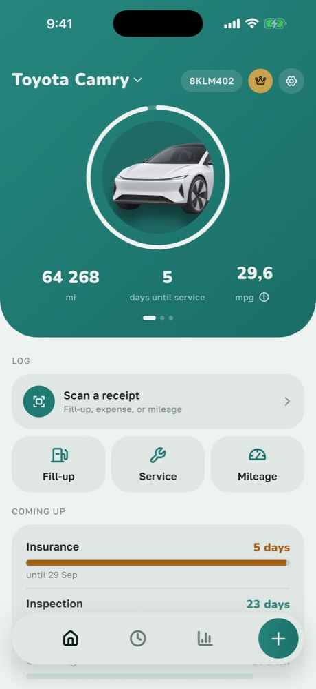
  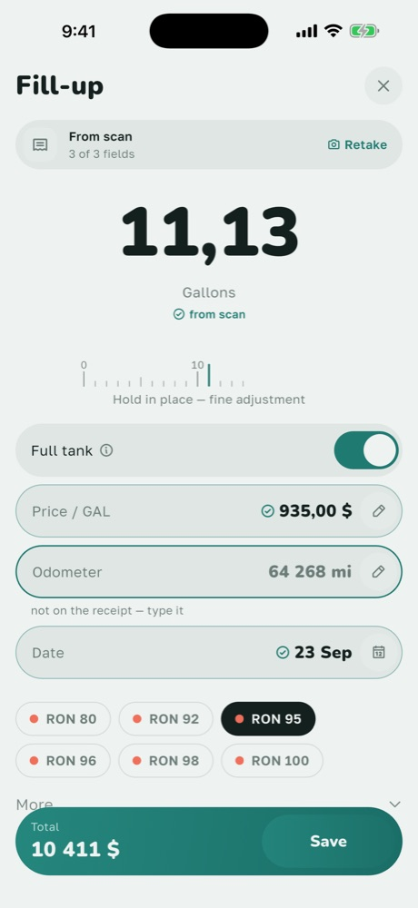
  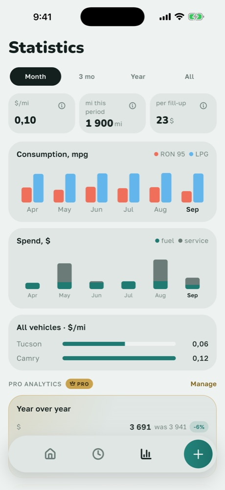
  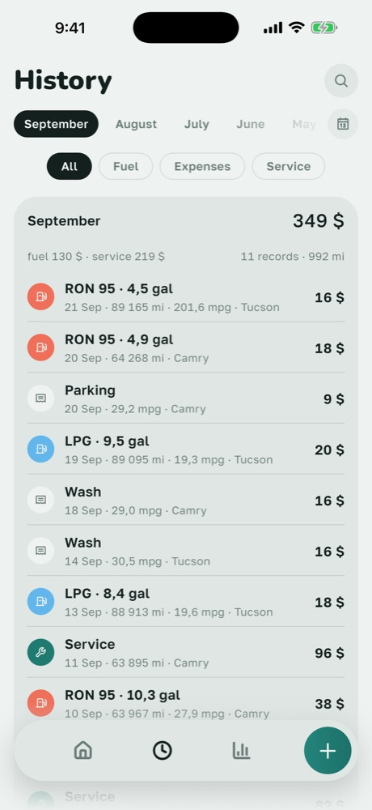
</p>

> **This is a showcase repository.** AutoNode is a commercial app, so its source code is private.
> This page describes what the app does, how it's built and what it took to ship.

---

## Overview

AutoNode keeps a car's whole running history in one place: fill-ups, service, expenses, mileage and upcoming maintenance. It turns that history into numbers drivers care about: real fuel consumption, cost per kilometre and monthly spend.

The project was built around three product bets:

1. **Design and comfort are the differentiator.** Given the choice between more features and a calmer, faster, more polished app, AutoNode picks calm.
2. **Trust through local-first data.** Vehicle records, odometer readings, plates, VINs and photos stay on the device. The only copy that leaves it is a backup to the user's own iCloud. There are no accounts.
3. **Local fit is data, not code.** Fuel types, expense categories, inspection rules and currencies come from seeded tables and a versioned rules config, not hardcoded conditionals. Adding a country or a fuel type (CNG, LPG, EV) is a data change.

## My role

I'm the **solo founder and developer**. I took AutoNode from idea to App Store release in about **3½ weeks** (September 2026):

- **Product:** wrote the PRD and competitor research, planned monetization, and wrote the design briefs for each redesign round.
- **Engineering:** built the whole Flutter app, the local database and its migrations, four serverless backend functions, iOS home-screen widgets, and full RU / EN / KK localization.
- **Quality:** worked test-first throughout and measured visual alignment on several simulator sizes.
- **Release and operations:** set up App Store Connect and in-app subscriptions, handled App Review, and wrote the store copy, screenshots and privacy policy / terms (EN + RU). Added crash reporting and anonymous product analytics.
- **AI-assisted workflow:** developed with Claude Code as a coding agent. I set the architecture rules, product decisions and quality bar, and reviewed and verified the output.

## Features

| | |
|---|---|
| **Fill-ups, service, expenses, mileage** | Fast entry with a custom numeric pad. Supports dual-fuel cars (petrol + LPG) and EVs (kWh). |
| **Honest consumption** | L/100 km is calculated only over full-tank-to-full-tank spans. Partial fill-ups count toward a span but never get their own figure. With too little data, the app shows "not available" instead of an estimate. |
| **AI receipt and dashboard scan** (Pro) | Photograph a fuel receipt or instrument cluster and the entry form fills itself. The scan only fills the form: every scanned entry goes through the same draft and validation as manual input. |
| **Multi-currency** | 12 currencies. Each entry is converted at the National Bank of Kazakhstan's official rate for that entry's own month, so old entries don't change value when the exchange rate moves. When no rate is available, totals are shown per currency instead of blended. |
| **Reminders** | Interval-based by days and/or kilometres (oil, insurance, the техосмотр inspection), with local notifications. |
| **Statistics** | Per-vehicle and cross-vehicle stats, cost per km, spend charts, a vehicle comparison and a Year-in-Review card. |
| **Service passport** | A PDF export of a car's service history. |
| **Widgets** | iOS home-screen widgets that show the next due item. |
| **Data ownership** | iCloud backup and restore, plus CSV import and export. |
| **Vehicle catalog** | A make/model catalog that updates remotely without an app release. Every picker also accepts typed entry, so onboarding never blocks. |
| **Localization** | Russian, English and Kazakh. Units (km/mi, L/gal, L/100 km/mpg) are converted only for display. |

<p align="center">
  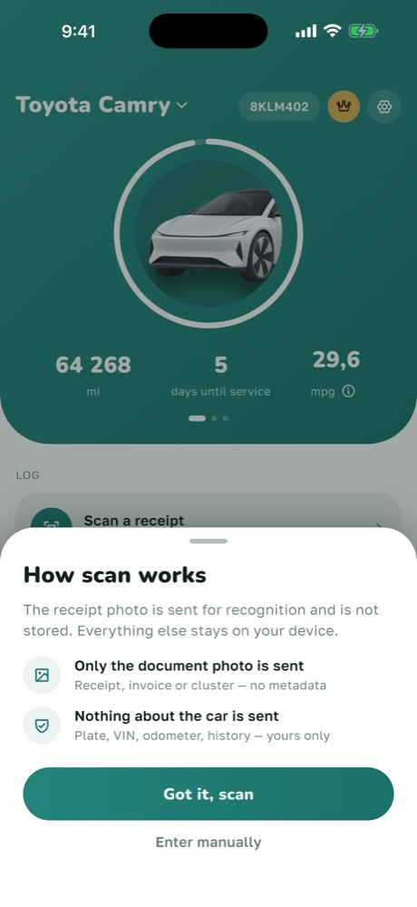
  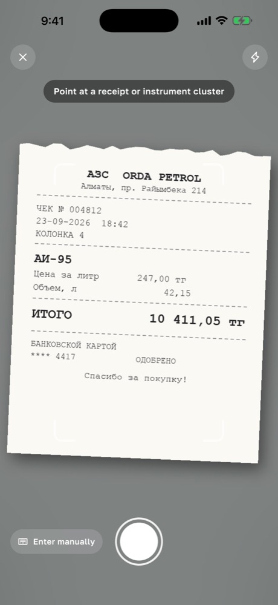
  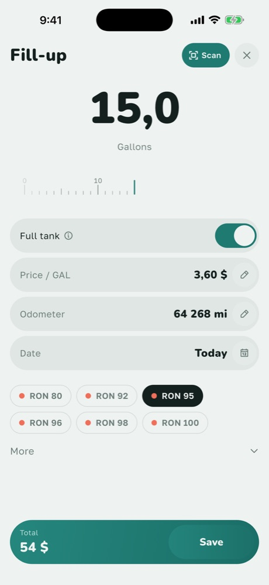
  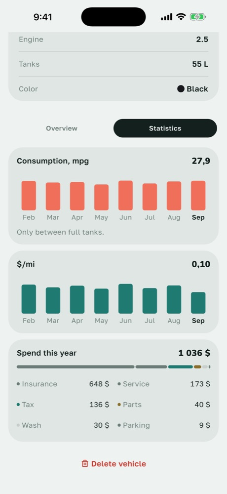
  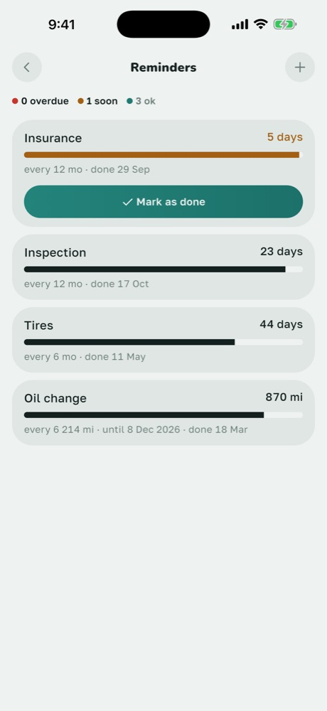
</p>

## Tech stack

**App:** Flutter / Dart · Riverpod (codegen) · go_router · Drift (SQLite) · flutter_local_notifications · Firebase Cloud Messaging · RevenueCat · PostHog · Sentry · Phosphor icons · `.arb` i18n (ru / en / kk) · Swift WidgetKit extension

**Backend (serverless, no personal data):** Supabase Edge Functions (TypeScript / Deno) · Gemini vision API · Resend · Vercel (legal site)

## Architecture

The code is organized by feature, with the same four layers inside each feature:

```
lib/
  core/        theme & design tokens, database, i18n, router, rules config, analytics
  features/
    <feature>/
      domain/        entities, repository interfaces, pure business logic
                     (consumption math, validation). No Flutter or database imports.
      data/          Drift-backed repository implementations (the only layer that touches SQL)
      application/   Riverpod providers and state notifiers
      presentation/  screens and widgets
```

17 feature modules: vehicles, fill-ups, expenses, mileage, reminders, history, stats, scan, backup, CSV transfer, service passport, subscription, widgets, feedback, update, intro and settings.

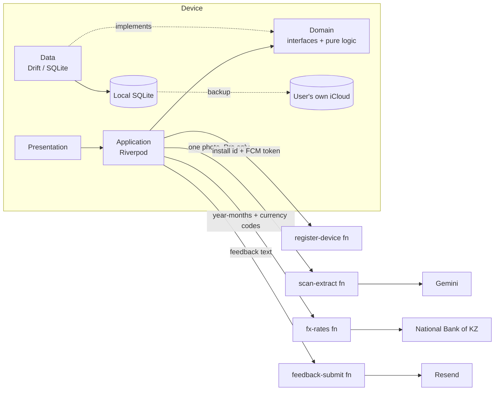

Key engineering decisions:

- **One draft, one validation path.** Manual entry and AI scan both produce the same `FillUpDraft` / `ExpenseDraft` value object, which goes through the same `validate()`. Future input methods like voice or CarPlay will reuse it.
- **Money stored as integer minor units with an ISO 4217 code on every row.** No floats and no implied currency.
- **Fuel types and expense categories are database tables, not enums.** Adding a new fuel is a seed row, not a migration.
- **Canonical storage units** (km, litres, kWh). Conversion happens only when displaying.
- **Migrations preserve user values.** Schema upgrades (currently v10) never replace a value the user entered with a default, and migration tests cover the fuel-grade and region-default upgrades.
- **Design tokens only.** Every colour, spacing, radius, type style and motion duration comes from a single tokens file. The accent colour is user-selectable from a palette of 8.
- **Motion only to confirm state.** Three durations, one easing family, skeleton loaders instead of spinners, and haptics in exactly three places.

## Privacy by design

- No accounts, no server-side copy of vehicle data, and no location tracking.
- Analytics are anonymous: a random, user-resettable device ID, with every event property drawn from a fixed approved list. No free text, amounts or vehicle identifiers.
- Each network call is a narrow, documented exception that carries only the minimum it needs. For example, the exchange-rate relay receives only year-months and currency codes, never amounts or exact dates.
- The receipt scan explains before its first use that a photo will leave the device. The photo is stored nowhere, and the AI provider runs on a paid tier that doesn't train on submitted content.

## AI receipt scan: how it was evaluated

Before shipping, I compared vision-model and OCR approaches on 20 real fuel receipts and dashboard photos:

- Sending the image straight to a vision model beat on-device OCR plus a parser. Receipt layouts vary too much, and OCR throws away the pixels needed to recover from its own misreads.
- The chosen model read **about 98% of fields correctly** and got every odometer reading right, including a dashboard that shows trip and total distance side by side. Median latency is about 3 seconds, and each scan costs **under $0.001**.
- The model's self-reported confidence turned out to be useless (it sat around 0.9 whether the answer was right or wrong). So the "please check this field" hints come from the app's own consistency checks, such as total ≈ volume × price and the odometer not going below its last value.

## By the numbers

| | |
|---|---|
| Time from first commit to App Store | ~3½ weeks |
| Dart source files | ~335 (~63k lines) |
| Automated tests | 500+ unit and widget tests, written test-first |
| Feature modules | 17 |
| Serverless functions | 4 |
| Languages | 3 (ru, en, kk) |
| Currencies | 12 |

## Screenshots

| Garage (RU, ₸) | Stats with Pro analytics | History |
|---|---|---|
| 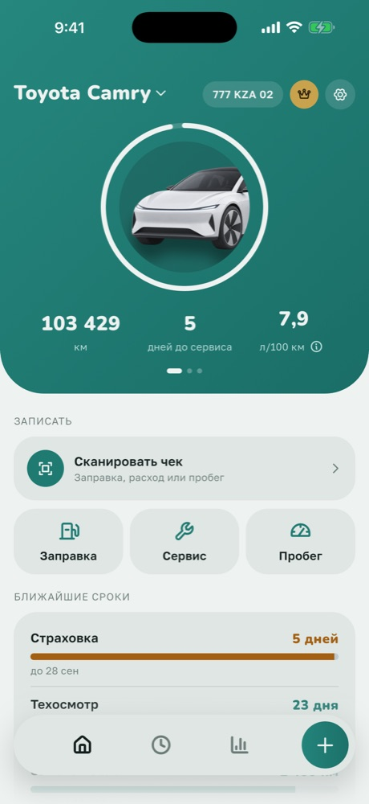 | 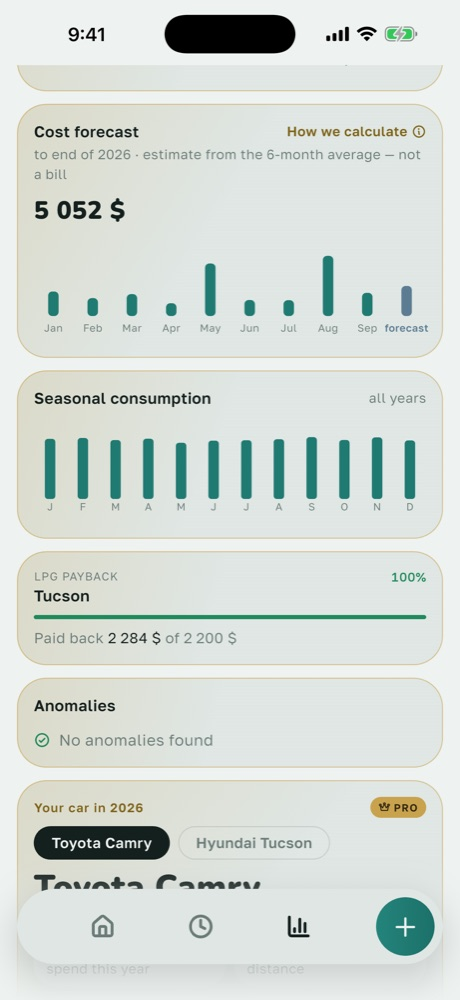 |  |

---

© 2026 AutoNode. All rights reserved. Source code available on request for hiring purposes.
